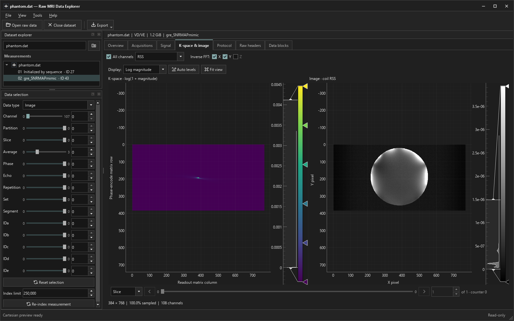
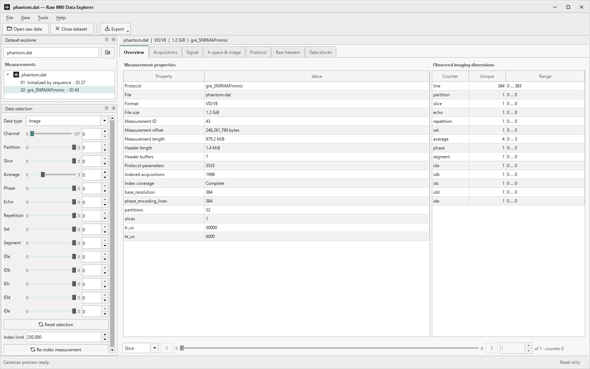
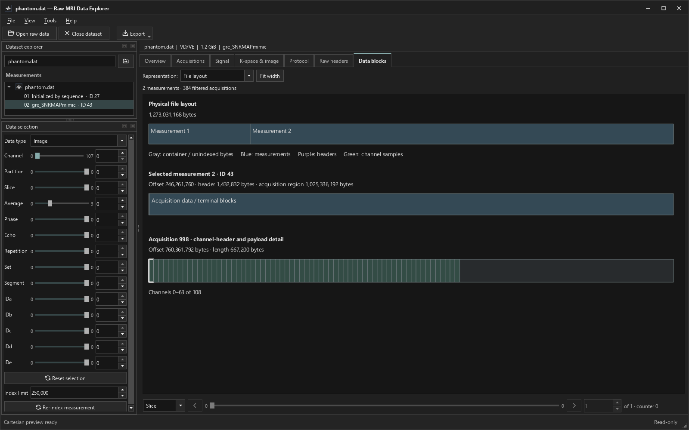

# Raw MRI Data Explorer

A native desktop program built with **Python, Qt (PySide6), NumPy, and pyqtgraph**. Its target is **Siemens MRI Twix RAWDATA (`.dat`)**, including VB and VD/VE files. It is not a general-purpose reader for every vendor's raw MRI format. The default **Modern dark** theme uses compact charcoal panels, restrained teal accents, and thin dock outlines. **Modern light** provides the same layout in soft whites and grays. Classic 90s light and dark themes are also available. Files are opened read-only and processed on this computer.

## Screenshots

**K-space and image — Modern dark.** Cartesian inspection preview with independent inverse FFT controls and RSS combination across 108 receive channels.



<details>
<summary>More views: measurement overview and physical file layout</summary>

**Measurement overview — Modern light.** Measurement properties, index coverage, and observed imaging dimensions alongside the dataset and selection panels.



**Data blocks — physical file layout.** Inspect measurement boundaries, protocol headers, and channel payloads using indexed metadata.



</details>

Captured from a Siemens phantom test file. Local paths and identifying fields are omitted; the displayed filename is `phantom.dat`. The source scanner file is not included.

## Run

On Windows, install **64-bit Python 3.10 or newer**, clone or download this repository, and double-click **`start.vbs`**. The launcher creates a local `.venv`, installs dependencies on the first run, and creates **`Raw MRI Data Explorer.lnk`** for later launches. A small startup splash appears while the imaging components load. `start.cmd` also forwards to this windowless launcher.

From PowerShell:

```powershell
.\start.ps1
.\start.ps1 -DataFile 'C:\data\meas_MID0001.dat'
```

The native application can also be launched directly:

```powershell
.\.venv\Scripts\python.exe -m siemens_explorer
.\.venv\Scripts\python.exe -m siemens_explorer 'C:\data\meas_MID0001.dat'
.\.venv\Scripts\python.exe -m siemens_explorer --theme dark --windowed
```

`python app.py` is an equivalent entry point. After installing the package with `python -m pip install -e .`, the Windows GUI entry point is `.venv\Scripts\raw-mri-data-explorer.exe`. The program does not need a browser, server, account, or API key.

For a fresh checkout, install 64-bit Python 3.10 or newer:

```powershell
py -3 -m venv .venv
.\.venv\Scripts\python.exe -m pip install -r requirements.txt
.\.venv\Scripts\python.exe -m siemens_explorer
```

The Windows launcher creates `.venv` and installs missing dependencies when necessary. Initial installation requires internet access. On macOS/Linux, use `python3 -m venv .venv` and `.venv/bin/python` instead of the Windows executable paths.

## Workspace

- Open a `.dat` file with the modern Windows file browser, or drag it onto the window. Open and Save use the operating system's native browser and appearance; application dialogs retain the selected theme.
- Use **Dataset explorer** to open files and select a measurement. **Data selection** is a separate panel for acquisition type, channel, and loop-counter controls.
- Acquisition counters use compact sliders with numeric entry. The leftmost position is **All**; other positions follow the values actually recorded, including gaps. The numeric arrows step through those observed values.
- Hover over a slider and use the wheel to change the selection without clicking first. Wheel down advances and wheel up goes back, one position per notch; small trackpad motions accumulate into steps.
- Select a receive channel with the **Channel** slider or numeric entry in **Data selection**. Its tooltip shows the channel count and physical receiver ID.
- Slider endpoints show the minimum and maximum values observed in the selected measurement/data type; the numeric field shows the current selection. Counter sliders retain their extra **All** position.
- The scrollable **Data selection** panel contains Data type, Channel, all acquisition-counter sliders, and index settings. The dimension controls follow Siemens Twix array order: Channel, Partition, Slice, Average, Phase, Echo, Repetition, Set, Segment, and IDa–IDe, consistent with [mapVBVD's raw-data order](https://github.com/pehses/mapVBVD#order-of-raw-data).
- **Data selection** and **Dataset explorer** can each be moved, detached into a window, resized, or closed. Drag a panel's title bar to move it; double-click to detach or dock it. **View > Data selection / Dataset explorer** restores a closed panel. Both use the selected theme when floating.
- Drag the divider between the two docked panels to resize Measurements and Data selection independently.
- Header indexing and preview construction run in the background. The status bar shows activity and allows cancellation. The default index limit is **250,000 acquisitions**; a partial index is labeled explicitly, and the limit can be raised before re-indexing.
- **Re-index measurement** and **Index limit** are at the bottom of **Data selection**. Re-indexing rescans the selected measurement's acquisition headers, preserving the data type, channel, and compatible counter selections; sample data is left on disk until viewed. **F5** also re-indexes.
- Switch between **Overview**, **Acquisitions**, **Signal**, **K-space & image**, **Protocol**, **Raw headers**, and **Data blocks**.
- Previews refresh automatically. Native menus and the toolbar provide file opening, appearance, indexing, and export actions.
- **View > Preview notes** shows the preview qualifications, hidden by default. Drag the divider above the notes to resize them. Routine controls explain themselves through tooltips.

| View | Purpose |
| --- | --- |
| Overview | Measurement properties, format, byte offsets, protocol summary, and observed imaging dimensions |
| Acquisitions | Sortable and filterable scan-header table; row selection chooses the signal readout |
| Signal | Magnitude, real/imaginary, phase, or FFT magnitude for an indexed acquisition and selected receive channel |
| K-space & image | Cartesian preview, independent X/Y/Z inverse FFT, RSS or adaptive channel combination, and partition-volume browsing |
| Protocol | Searchable ASCCONV paths and scalar XProtocol parameters, preserving stored names and units |
| Raw headers | Buffer dropdown, expandable parameter-path tree with search, and the original stored text alongside it |
| Data blocks | Clickable visual map of file, measurement, acquisition, and channel blocks with byte offsets, lengths, and payload metadata |

All acquisition counters are the scanner's zero-based values. Receive-channel ordinal is the position within an acquisition; physical channel IDs are checked before building a coherent Cartesian preview.

Choose **Noise** in the sidebar's **Data type** to inspect noise readouts. If the selected measurement has none, the viewer searches the other measurements' headers within the current index limit and selects one containing noise. Noise mode shows a raw complex-sample matrix for the selected channel; **Signal** provides individual readout plots. Rows follow acquisition order and columns are sample indices. Noise is displayed without an image reconstruction. NPZ export uses `raw_samples`, `magnitude`, and `acquisition_indices` for this mode.

The **Data blocks** view renders a bounded overview of the indexed structures without reading signal payloads. Hover to inspect metadata; click a channel block to select its readout in **Signal**. It does not edit the source file or require a full-file image allocation.

### Browse slices

Use the previous/next buttons, slice slider, or position field at the bottom of the data display to move through slices. In **K-space & image**, they sit directly below the images and above any preview notes. Positions follow the observed scanner counters, including noncontiguous values; the sidebar selection stays synchronized. The axis selector also supports partitions, selected automatically for datasets with one slice and multiple partitions.

Opening **K-space & image** builds the first preview automatically. Scrolling over an image moves between slices; hold **Ctrl** while scrolling to zoom. Changing slice refreshes the preview in the background. Rapid scrolling keeps the latest requested position, preserving the selected echo, receive channel, coil combination, zoom, and window levels. Controls are disabled when only one position is available.

### Browse receive channels

Use the **Channel** slider in **Data selection** to view a coil individually, or type a zero-based channel number beside it to jump directly. The wheel advances one channel per notch. Selection updates the complex readout and image preview automatically and turns off channel combination; clicking the current slider thumb also returns to that individual channel. **Ctrl+Left / Ctrl+Right** moves through channels while keeping the slice and echo fixed. Hover over the slider or number to see the physical receiver ID and total channel count, including when physical IDs are noncontiguous.

Check **All channels**, then choose **RSS** or **Optimal (adaptive)**. RSS combines coil magnitudes. Adaptive combination estimates smooth, complex channel responses on a small grid and combines the coils coherently with a noise-weighted matched filter. It uses matching physical receiver IDs from `NOISEADJSCAN` in the current measurement, then searches the nearest preceding measurements in the same file. Calibration uses up to 8,192 samples and 32 noise readouts, removes channel means, and regularizes the covariance. When matching noise is unavailable, the view explicitly says **assumed noise**, using equal uncorrelated noise. Two passes stream one coil at a time, avoiding a full-resolution coil stack.

The adaptive weights follow the spatial matched-filter principle described in [The NMR phased array](https://pubmed.ncbi.nlm.nih.gov/2266841/). Their SNR performance depends on the estimated responses and noise calibration; the displayed magnitude is in relative signal units, not an absolute SNR map. Locations without usable response estimates fall back to RSS, recorded in Preview notes and NPZ metadata. Selecting a channel returns to its individual image. Channel browsing preserves zoom and window levels.

### Choose inverse FFT axes

The three **Inverse FFT** checkboxes act independently: **X** is readout samples, **Y** is phase-encode lines, and **Z** is partition encoding. X and Y start checked; Z starts off. Turning an axis off leaves that axis in k-space; the right pane's title and axes identify a hybrid or k-space view. The left pane always retains the selected channel's raw k-space.

Z is available for partition-encoded data. It gathers every acquired partition for the selected slice, echo, repetition, and other counters; the raw Partition filter is disabled while Z is on. A **Z plane** slider appears directly below the images, with wheel and Page Up/Down navigation through reconstructed planes. It does not reread data to change planes. Raw partition counters and reconstructed plane indices are labeled separately. Separate 2D slices are never Fourier transformed together. For a volume, NPZ arrays use Z/Y/X order and include axis settings and raw partition counters in metadata.

## Export

Exports use native save dialogs:

- Acquisition table: CSV.
- Selected complex readout: CSV with real, imaginary, magnitude, and phase values.
- Measurement metadata and parsed protocol: JSON.
- Original named header buffers: text.
- Cartesian preview: compressed NumPy NPZ, including `kspace`, `image`, `coverage`, `lines`, metadata, and preview qualifications.
- Signal plot or paired k-space/image view: PNG.
- **ISMRMRD dataset**: HDF5 `.h5` / `.mrd`, exported in a cancellable background job.

NPZ files can be opened with `numpy.load(path, allow_pickle=False)`. Exports preserve data and do not modify the source `.dat` file.

ISMRMRD export includes **all indexed ADC acquisitions and channels of the selected measurement**, independently of display filters and inverse-FFT settings. It streams the original complex samples, maps physical receiver IDs to consistent MRD channels, and retains MDH counters, flags, available geometry, protocol buffers, and original ADC headers. Incomplete indexing is recorded in the XML metadata. Sync/PMU records without ADC samples are skipped and counted; trajectories are not synthesized. Missing timing/FOV/geometry values remain zero and are identified in export notes. This is a general raw-data export rather than sequence-specific scanner reconstruction. The output can be read with the [official ISMRMRD Python library](https://github.com/ismrmrd/ismrmrd-python); the format is documented in the [ISMRMRD acquisition specification](https://ismrmrd.readthedocs.io/en/latest/mrd_raw_data.html).

Raw-header navigation preserves the original text. The expandable tree groups stored ASCCONV paths and scalar header parameters; selecting a leaf locates that parameter in the source buffer. Search filters the tree and searches the text. The display is bounded to 2 MiB of source text and 4,096 parsed fields; header export preserves the complete buffers.

## Controls

| Shortcut | Action |
| --- | --- |
| Ctrl+O / Ctrl+W | Open raw data / close dataset |
| Ctrl+1 through Ctrl+7 | Select a workspace tab |
| Page Up / Page Down | Previous / next slice or partition |
| Ctrl+Left / Ctrl+Right | Previous / next receive channel |
| F5 | Re-index measurement |
| Esc | Cancel the current background operation |
| F11 | Toggle full screen |

Drag inside plots to pan. Scroll over images to navigate slices; use Ctrl+scroll to zoom. Signal plots retain scroll-to-zoom. Image histograms control window/level; **Auto levels** and **Fit images** restore useful display defaults. Appearance can be changed through **View > Appearance**. The first launch is maximized; later launches restore the previous window geometry and mode. `--windowed` opens a normal window.

Choose **Modern dark** or **Modern light** through **View > Appearance**. The palette covers the workspace, startup splash, floating panels, dialogs, captions, glyphs, and plot controls. Modern dark is the default and retains the `cockpit` theme identifier. To start in modern light, use `--theme modern-light` or `.\start.ps1 -Theme modern-light`. **Classic light / Classic dark** retain the 90s controls and the `light` / `dark` launch options.

Closing the app saves its theme and dock layout in your per-user Qt settings, including panel positions, sizes, detached windows, and hidden panels. The next launch uses that theme for the splash as well as the workspace. **View** restores panels you previously closed. An explicit `--theme` / `-Theme` overrides the remembered theme; normal shortcuts and launchers use the saved choice. Floating panels saved on a disconnected monitor are moved back onto an available screen. Raw-data files are not stored in these preferences.

The palettes, fonts, control styles, captions, plot colors, and block-map colors are editable in `siemens_explorer/resources/themes/`. Original SVG control glyphs are in `resources/glyphs/`. Use **View > Appearance > Open theme assets folder**, edit the assets, then **Reload appearance assets** (**Ctrl+Shift+R**) to apply them without reopening data. Invalid theme edits retain the current appearance. See [the asset guide](siemens_explorer/resources/ASSETS.md) for file names and tokens.

Edit **[logo.svg](logo.svg)** in the project root to change the program's logo. **View > Appearance > Open logo folder** opens its location. Restart or use **Reload appearance assets** to update window/title-bar icons and subsequent dialogs/splash screens. The Windows ICO is regenerated from this SVG on launch/reload, and the same SVG supplies the About logo and measurement-tree icon. An installed package without a project-root SVG uses the bundled `resources/app-icon.svg`.

Matching `.lnk` shortcuts in the project folder update automatically on launch/reload. Each logo version gets its own icon file in `.cache/icons` so Explorer does not reuse a stale image; Windows is notified about changed shortcuts.

The compact title bar follows the selected theme. Drag it to move the window, double-click it to maximize or restore, and use the edges or corners to resize. Its window menu is available from the application icon or **Alt+Space**. Classic themes retain black title text and square buttons.

## Format support and limits

The reader supports **Siemens MRI Twix VB single-measurement and VD/VE multi-RAID layouts**, including 128-byte VB / 192-byte VD/VE acquisition headers, receive-channel IDs, all 14 loop counters, evaluation flags, and complex float32 signal payloads. Samples are read one acquisition/channel at a time instead of loading the entire file. Header sizes and read boundaries are checked. Truncated files retain usable acquisition prefixes, and intact earlier RAID measurements remain accessible when trailing measurements are unavailable.

The `.dat` extension is also used by unrelated products. This program targets MRI Twix; it does not read arbitrary Siemens industrial data, DICOM images, or encrypted/proprietary variants outside these layouts.

The Cartesian image is an **inspection preview**, not a scanner reconstruction. It aligns readouts using MDH center counters, reverses reflected readouts, averages repeated positions, leaves missing samples zero, and applies centered inverse FFTs along the selected axes. Mixed slices, echoes, repetitions, other loop counters, and inconsistent physical receive-channel IDs are rejected. Partitions may vary when Z inverse FFT is selected. Matrix and memory limits are checked before loading image payloads; large 3D groups may exceed the 128 MiB preview working-memory limit.

Displayed matrix bounds are inferred from observed MDH counters. Preview coverage describes the allocated matrix and cannot establish the prescribed matrix, full sampling, or acceleration. Trajectory is not validated. Regridding, ramp-sampling correction, parallel imaging, SMS reconstruction, oversampling removal, noise prewhitening, sensitivity correction, and scanner image orientation are not applied. Non-Cartesian or sequence-specific data require an appropriate reconstruction before interpreting an image. The preview is limited to 2,048 pixels per axis and a conservative 128 MiB estimated working-memory budget.

Automated verification uses generated VB/VD fixtures, malformed/truncated inputs, numerical checks, and Qt integration tests. Manual checks also used a 108-channel Siemens VD/VE file, including individual channels, layout inspection, noise data, and an ISMRMRD round trip. This is limited compatibility evidence, not validation of every scanner or sequence. No scanner files are included in this repository. This is research and inspection software.

## Python API

```python
from siemens_explorer.twix import TwixFile
from siemens_explorer.analysis import scans_to_frame, select_scans, build_cartesian_preview

with TwixFile("measurement.dat") as raw:
    measurement = raw.measurements[-1]
    index = raw.index_measurement(measurement, max_scans=250_000)
    table = scans_to_frame(index.scans)
    group = select_scans(index.scans, {
        "is_image": True, "slice": 0, "partition": 0, "echo": 0,
        "repetition": 0, "average": 0, "set": 0, "phase": 0,
        "segment": 0, "ida": 0, "idb": 0, "idc": 0, "idd": 0, "ide": 0,
    })
    signal = raw.read_signal(measurement, group[0], channel_index=0)
    preview = build_cartesian_preview(raw, measurement, group, all_channels=True)
```

## Tests

```powershell
.\.venv\Scripts\python.exe tools/run_tests.py
```

The runner executes each test module in a separate process to isolate Qt application state. Tests cover binary layout variants, multiple measurements, payloads and physical channel IDs, evaluation flags, truncated input, index limits, protocol extraction, FFT recovery, reflection, duplicate averaging, missing lines, mixed groups, allocation guards, and desktop controls/exports. GitHub Actions runs the suite on Windows with Python 3.12 and 3.13 and builds the Python distributions.

## Development and license

See [CONTRIBUTING.md](CONTRIBUTING.md) for setup, testing, and contribution guidelines, and [docs/ARCHITECTURE.md](docs/ARCHITECTURE.md) for the code map and data contracts. Source, appearance assets, documentation, and tests belong in Git; virtual environments, caches, generated shortcuts, exports, and raw-data files are excluded. Test fixtures are generated locally rather than stored scanner datasets.

Released under the [MIT License](LICENSE). Third-party dependencies retain their own licenses.

The independent binary reader follows layout definitions documented by [twixtools MDH schemas](https://github.com/pehses/twixtools/blob/master/twixtools/mdh_def.py) and [mapVBVD](https://github.com/pehses/mapVBVD/blob/main/mapVBVD.m). The desktop interface uses [Qt for Python](https://doc.qt.io/qtforpython-6/) and [pyqtgraph](https://www.pyqtgraph.org/).
